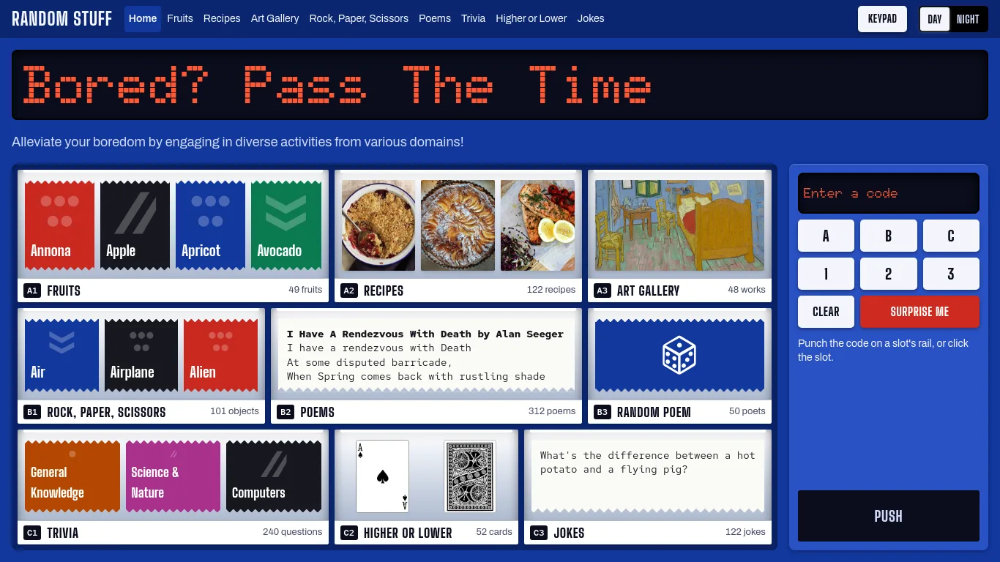
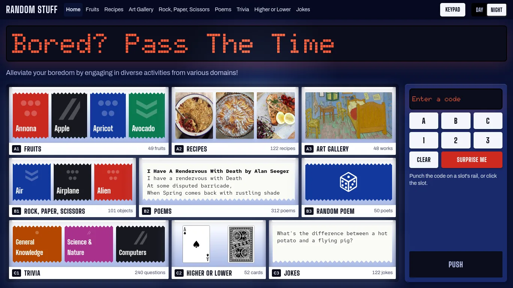
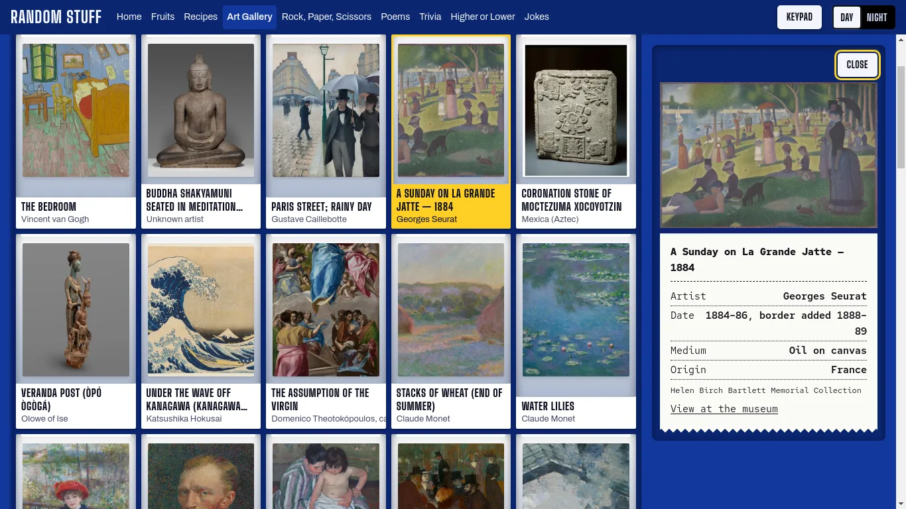
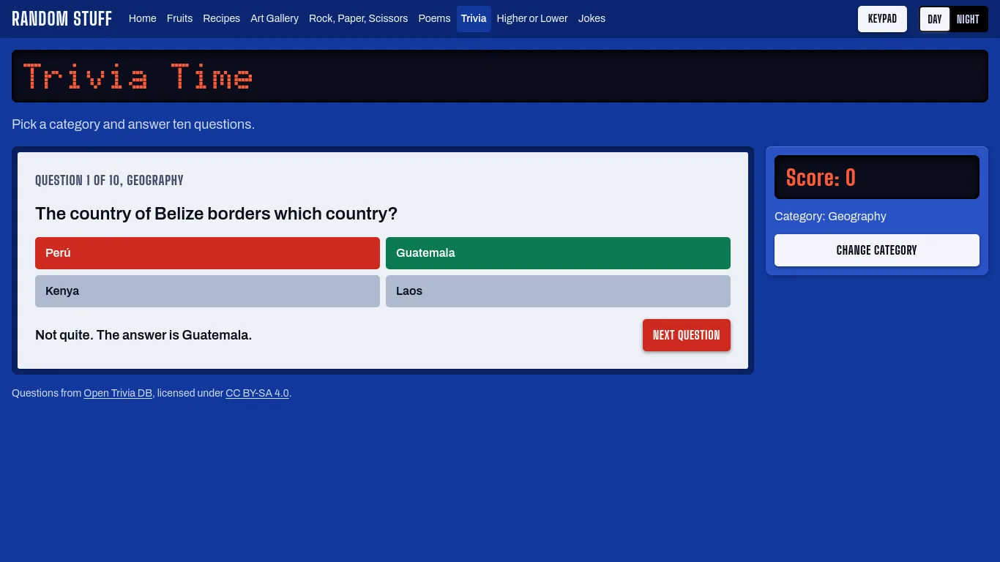
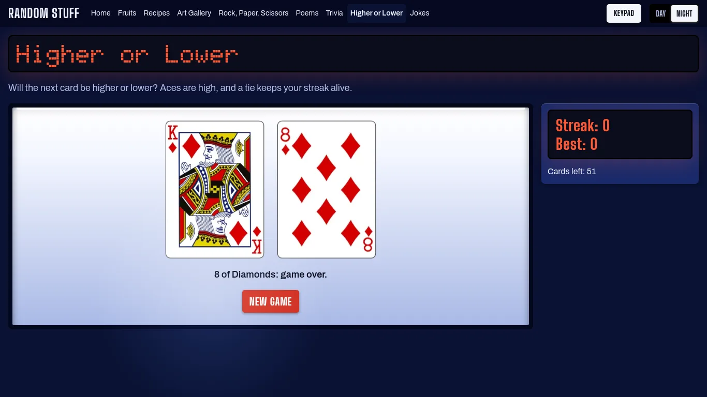
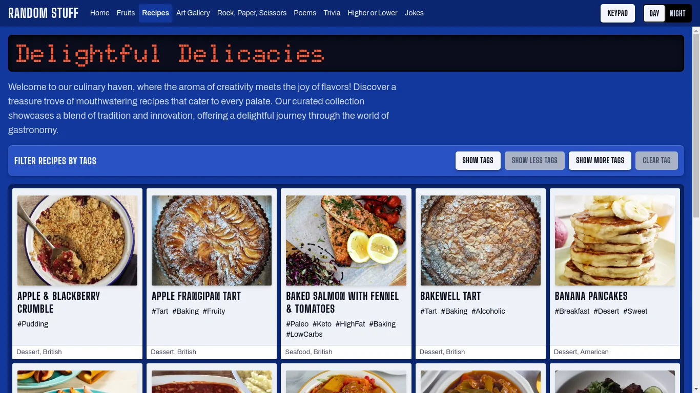

<h1 id="title" align="center">Random Stuff</h1>

<p align="center"></p>

<p id="description">A collection of small, unrelated things to do when you're bored, styled as a street vending machine. Every activity sits in a coded slot: click a compartment, or punch its code into the keypad (<code>A3</code> opens the art gallery) and watch it dispense. The site is a fully static Next.js export: all content is stored in the repo and baked into HTML at build time, so it needs no database or API keys, and keeps working if any of its source APIs go down. It's also an installable progressive web app.</p>

<h2>🚀 Demo</h2>

[https://random-stuff-one.vercel.app/](https://random-stuff-one.vercel.app/)

<h2>📸 Screenshots</h2>











<h2>🧐 Features</h2>

| Code | Activity | What you can do |
| :--- | :--- | :--- |
| A1 | Fruits | Browse 49 fruits and print a label with their family, genus and nutrition |
| A2 | Recipes | Browse 122 recipes, filter them by tag and read the full method |
| A3 | Art Gallery | Browse 48 public-domain artworks and print a label for each one |
| B1 | Rock, Paper, Scissors | Play against the computer with 101 objects instead of three |
| B2 | Poems | Read 312 poems, by poet or by title |
| B3 | Random Poem | Print a random poem and shuffle for another |
| C1 | Trivia | Pick one of 8 categories and answer ten questions |
| C2 | Higher or Lower | Guess the next card in a 52-card deck and build a streak |
| C3 | Jokes | Print a joke on a receipt, then reveal the punchline |

Across the whole site:

*   A working keypad: punch any code above, or press **Surprise me** for a random activity
*   Day and night modes, remembered between visits
*   Works on phones, by keyboard, and with reduced motion
*   Installable as a progressive web app

<h2>💻 Built with</h2>

*   [Next.js 14](https://nextjs.org/) (static export) and React 18
*   TypeScript
*   Tailwind CSS
*   [GSAP](https://gsap.com/) for the LED title animation and the dispense animation
*   [Cypress](https://www.cypress.io/) for end-to-end tests

The visual design is documented in [DESIGN.md](./DESIGN.md).

<h2>📦 Requirements</h2>

* [Bun](https://bun.sh/)
* [Node.js 26](https://nodejs.org/), which Next.js runs on and Vercel builds with

<h2>🛠️ Getting started</h2>

1. Clone the repo and change into it

```bash
git clone https://github.com/mdesignscode/passthetime/
cd passthetime
```

2. Install dependencies

```bash
bun install
```

3. Start the development server at http://localhost:3000

```bash
bun run dev
```

<h2>📜 Scripts</h2>

| Command | What it does |
| :--- | :--- |
| `bun run dev` | Start the development server |
| `bun run build` | Build the static site into `out/` |
| `bun run start` | Serve the built `out/` folder |
| `bun run lint` | Run ESLint |
| `bun run refresh-content` | Refetch the trivia, art, jokes and cards (see below) |

<h2>🗃 Content</h2>

All content lives in the repo and is read at build time through `lib/data.ts`:

* `data/*.json` holds every activity's data
* `public/images/` holds the recipe photos, artworks and playing cards

To change content, edit those files and rebuild. To fetch a fresh set of trivia questions, artworks, jokes and cards, run `bun run refresh-content`. It only updates `data/` once every source has responded, although new images are saved as they download. The fruits, recipes, poems and Rock, Paper, Scissors objects were fetched once and are edited by hand.

<h2>🧪 Testing</h2>

The Cypress tests run against a built copy of the site and a small test API in `cypress/api`.

1. Build the site and serve it on port 3000

```bash
bun run build && bun run start
```

2. In a second terminal, install and start the test API on port 3001

```bash
cd cypress/api && bun install && PORT=3001 bun run src/index.ts
```

3. In a third terminal, run the tests against your local copy. Without `--env`, they run against the live demo.

```bash
bunx cypress run --env hostname=http://localhost:3000/
```

<h2>🙏 Credits</h2>

Content comes from these public APIs:

* [Fruityvice](https://www.fruityvice.com/) for fruit data
* [TheMealDB](https://www.themealdb.com/) for recipes and photos
* [PoetryDB](https://poetrydb.org/) for poems
* [RPS-101](https://www.umop.com/rps101.htm) by David C. Lovelace for the 101 objects and their outcomes, fetched through a now-retired API
* [Open Trivia DB](https://opentdb.com/) for trivia questions, licensed under [CC BY-SA 4.0](https://creativecommons.org/licenses/by-sa/4.0/)
* [Art Institute of Chicago](https://api.artic.edu/docs/) for artworks, public domain only
* [JokeAPI](https://v2.jokeapi.dev/) for jokes, fetched in safe mode
* [Deck of Cards](https://deckofcardsapi.com/) for card images

These APIs were found through the [public-apis](https://github.com/public-apis/public-apis) list.

<h2>🛡️ License</h2>

The code is licensed under the MIT License; see [LICENSE](./LICENSE). The content credited above stays under its sources' own terms, so the trivia questions remain under CC BY-SA 4.0.
